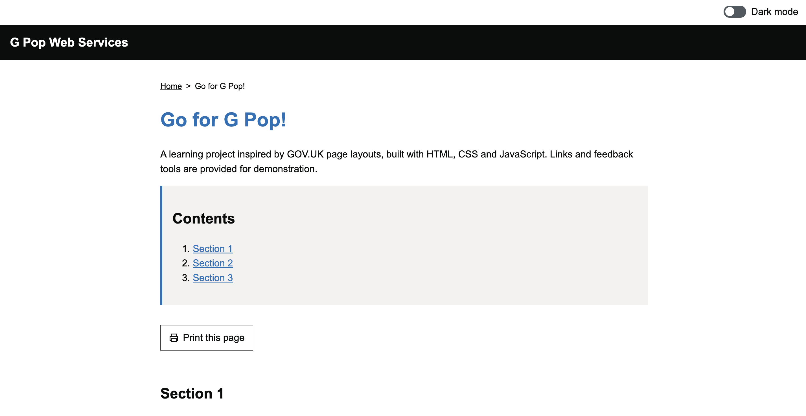

# G Pop Web Services

A learning project inspired by the GOV.UK Success Profiles: Experience page,
built step by step with HTML, CSS and JavaScript.

I used Git through the terminal to track changes, and GitHub and GitHub Pages
to share the code and publish the website.

ChatGPT provided guidance throughout – especially on terminal commands, the Git and GitHub
workflow, and the final project tidy-up.

The page uses my own branding and additional interactive features.
This is an independent learning project, not affiliated with GOV.UK.

## Live website

[View the live website](https://mepopis.github.io/g-pop-web-services/)

## Preview

## Features

- Responsive page layout
- Sticky light/dark mode switch
- Theme preference saved in browser storage
- Contents links to page sections
- Print button and printer icon
- Demo feedback buttons and report form
- Demo resource page with a return link
- Keyboard skip link and visible focus outlines

Feedback and reports are demonstrations. They are not sent
or stored.

## View locally

Download the project files into one folder and open
index.html in a browser.

## What I am learning

- Semantic HTML and accessible controls
- CSS layouts and responsive styling
- JavaScript events and browser storage
- Saving progress with Git and GitHub